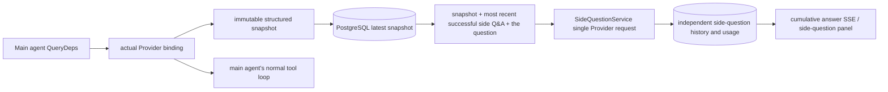

# ARTEX `/btw`

Ordinary chat, a task's MainAgent and the current task's own Worker support independent side questions. Type `/btw question` in the main input box to submit; an empty `/btw` or the "side question" button opens the history. Desktop uses a width-adjustable side panel, mobile a Drawer.

A side-question answer is generated from the agent context snapshot at the moment of submission, and supports streaming display, follow-ups, stop and clear. Closing the panel, refreshing the page or dropping the SSE does not cancel the model request. Stop only affects the current side question; clear cancels the side question and deletes the side-question history, while keeping the main context snapshot.

## Implementation boundaries

It reuses Go, norma v0.3.7, Next.js and the existing Markdown / ResizablePanel / Drawer / AlertDialog components; no norma source was modified and no dependency was added for side questions. The Planner, a Worker inherited from another task, and tool-type sub-task upgrades are out of scope this time.

- `capture.go` marks a main-loop request only on `Options.Deps.CallModel / CallModelSync`. The Provider decorator sits inside the concrete model, after the routing pool's selection, so it records the model actually chosen; compaction and summary requests do not overwrite the snapshot.
- The snapshot is published at request start, on a complete model reply, and at a run's terminal state. A half-generated reply in progress is not published; tool calls stay paired via norma's `MessagesForAPI`, and a tool result enters the snapshot at the next main-model request or the run's terminal state. A stream abort keeps the last valid boundary.
- The snapshot keeps the structured messages, system prompt, tool definitions and generation parameters via a JSON deep copy. Model inference holds neither the snapshot lock nor a database transaction.
- `SideQuestionService` calls the concrete Provider; it generates a side-question summary first when needed, and the final answer is only allowed to shrink and retry once on the first context overflow before any text/tool call has been output. It creates no agent session, is not wired to the tool executor, the main transcript, the activity stream or the task graph, and does not go through the task model switch chain. The answer keeps the tool definitions for compatibility with the existing structured tool context; the summary request provides no tools. A newly returned tool call has no execution path.
- One running request per parent session, at most four per service process, with a 120-second timeout per request. The side question uses an independent cancellation context under the service lifecycle.
- A side-question request keeps a reference to the model config and a non-sensitive identity summary; credentials are taken from the existing config at request time. If the config is deleted, or an identity field such as the model, protocol or address changes, it requires the main agent to be run first to update the snapshot. Tests do not change the product's default model.

## Persistence and recovery

`db/schema.sql` auto-creates `side_question_sessions` and `side_question_requests`. The former saves the parent resource, the latest snapshot, the run number, the version and the clear version; the latter saves the question, the cumulative answer, status, model, snapshot time, usage, event sequence number and paging sequence number.

The parent session key uses the conversation ID, or the task ID + exploration ID + intent ID. A Worker does not use the reusable execution-slot naming.

Snapshots are written merged per parent session, flushed every 250 ms, and the database compares `(run_id, version)` to stop an older version overwriting. The selected snapshot is saved again before a side question is submitted. After a successful save the large in-memory snapshot is released; on failure the pending version is kept. The cumulative answer content is written at most every 250 ms as streaming events arrive, saved immediately at the terminal state, with limited retries on a database error.

At service start-up, a leftover `running` request is marked `interrupted`, keeping the partial answer and usage already stored, without replaying the request automatically. The most recently saved context can be used directly for the next question. When an old session has no snapshot it requires the main agent to be run first, and the context is not rebuilt from the UI activity records.

A clear operation increments the clear version and deletes the requests; a conditional update stops a late callback writing back again. A physical parent-resource deletion relies on the foreign-key cascade, and a Worker's logical deletion deletes the side-question data in the same transaction and rejects a subsequent late snapshot. Task archiving first blocks new requests, waits for the main flow to stop, then cancels and waits for the side question to be stored; the archive format is v3, also compatible with v1/v2 that have no side-question tables.

The history is kept in full and returns at most 20 per page by a sequence-number cursor. A model request replays at most the raw text of the 20 most recent successful Q&As, while limiting the replayed amount by a token budget; older Q&As are kept in an independent rolling summary. When the main context is over budget, only the older part of the side copy is summarised, keeping the recent structured tool calls and results. The summary, preparation progress and usage are all subject to the side question's concurrency, cancellation and 120-second timeout limits. See [Context budget and open-source references](CONTEXT_BUDGET.md).

## HTTP contract

The following paths act as `{parent}`, following the existing authentication and resource checks:

- `/api/conversations/{id}`
- `/api/tasks/{id}/chat`
- `/api/tasks/{id}/intents/{iid}`

| request | return and behaviour |
| --- | --- |
| `GET {parent}/side-questions?before={ordinal}` | `items` ordered newest to oldest, an independent `current` run state, `snapshot` metadata, `next_cursor`; a cursor of 0 means the newest page / no next page |
| `POST {parent}/side-questions` | JSON `{ "question": "…", "client_request_id": "UUID" }`; a new request returns 202 and the request object; the same ID and question returns the existing object with 200 |
| `DELETE {parent}/side-questions` | cancel and clear the current parent session's side Q&As |
| `GET /api/side-questions/{requestID}/events` | `snapshot` SSE events, with `id` an increasing sequence number and `data` the complete cumulative request object; on clear a `cleared` is sent |
| `POST /api/side-questions/{requestID}/cancel` | explicit cancel; the terminal state can be read from the history or SSE |

The question cap is 4000 characters. No snapshot, a model config change, the same parent session busy, or an idempotent ID conflict returns 409; the global concurrency limit returns 429. Every SSE connection sends the cumulative state first, not relying on text fragments the client received before. The frontend merges by request ID + sequence number, and discards old callbacks when switching parent session or clearing.

## Validation and references

Automated checks, real model usage and known limitations are in [VALIDATION.md](VALIDATION.md).

For the independent request see [Grok CLI side-question.ts (pinned commit)](https://github.com/superagent-ai/grok-cli/blob/fb97af83f06dca873281d60168430f06c8de6324/src/utils/side-question.ts); for run isolation see [OpenCode (pinned commit)](https://github.com/anomalyco/opencode/tree/b3f1a96c6dd7adeb28b36dd11add1998fc84d67b). ARTEX's context uses norma's structured messages, not the approach of splicing text from frontend logs.
